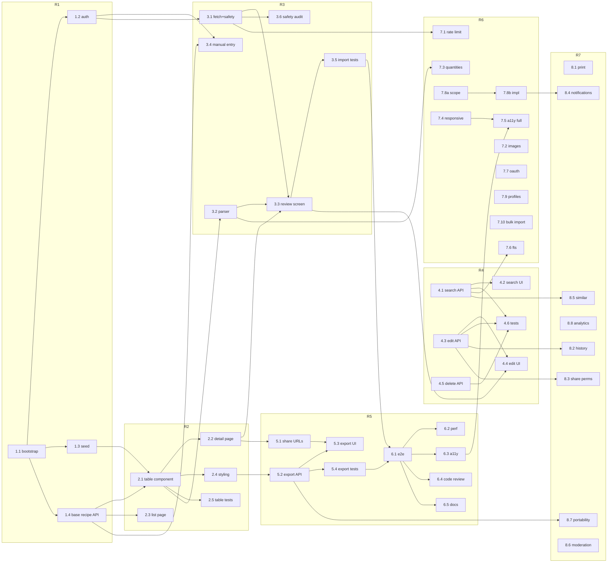

# RELEASE_PLAN: Recipe Book — Waves, Releases & Parallelization

**Inputs**: `docs/PROJECT.md` (task list), `docs/PRD.md` (P0/P1/P2 tiers), `milestones/01–05`
**Goal**: spread all 38 tasks across 7 releases, maximize parallel work across agents, and enforce dependency ordering so no two dependent tasks run at the same time.

> **PM note — gap found & closed**: the task list has no explicit task for the basic recipe read/create API that Tasks 2.2, 2.3, 3.3 and 3.4 all depend on. This plan adds **Task 1.4 (Base Recipe API)** in Release 1 to unblock the frontend waves.

---

## Release Overview

| Release | Phase | Weeks | Waves | Launch gate |
|---|---|---|---|---|
| **R1** | Foundation | 1–2 | 2 | `npm run lint && typecheck && test` pass; seed + auth + base API live |
| **R2** | Strict Table View | 3–4 | 2 | Table renders seeded reference layout; unit tests green |
| **R3** | URL Import | 5–6 | 3 | Import flow end-to-end; safety audit clean; integration tests green |
| **R4** | Search / Edit / Delete | 7 | 3 | Ownership enforced; tests green |
| **R5** | Share / Export + QA | 8–9 | 3 | All P0 done; QA gate (6.1–6.4) passed; docs merged |
| **R6** | P1 Features | 10–14 | 3 | P1 features ship independently; a11y full pass |
| **R7** | P2 Features | 15+ | 3 | P2 backlog cleared |

---

## R1 — Foundation (Weeks 1–2)

### Wave 1.1
| Task | Agent | Prereqs | Notes |
|---|---|---|---|
| **1.1** Project bootstrap | `engineering-software-architect` | — | Critical path; blocks everything |

### Wave 1.2 (3 tasks, 3 agents, fully parallel)
| Task | Agent | Prereqs | Notes |
|---|---|---|---|
| **1.2** Auth (register/login/logout/reset) | `engineering-identity-access-engineer` | 1.1 | |
| **1.3** Seed data | `engineering-database-reliability-engineer` | 1.1 | |
| **1.4** Base Recipe API *(new)* | `engineering-backend-architect` | 1.1 | `GET /api/recipes` (list, public, paginated), `GET /api/recipes/[id]` (detail, public/owner), `POST /api/recipes` (auth, create). Unblocks 2.2, 2.3, 3.3, 3.4 |

Wave 1.2 can start as soon as 1.1's Prisma schema + env + CI are merged; the three agents touch disjoint areas (auth routes, seed script, recipe routes).

---

## R2 — Strict Table View (Weeks 3–4)

### Wave 2.1 (2 tasks, 2 parallel FE sessions)
| Task | Agent | Prereqs | Notes |
|---|---|---|---|
| **2.1** RecipeTable component | `engineering-frontend-developer` | 1.1, 1.3, 1.4 | Critical path for 2.2/2.4/2.5 |
| **2.3** Recipe list page (`/`) | `engineering-frontend-developer` | 1.4 | Independent of 2.1 — no table involved |

### Wave 2.2 (3 tasks, 3 agents, fully parallel)
| Task | Agent | Prereqs | Notes |
|---|---|---|---|
| **2.2** Recipe detail page (`/recipes/[id]`) | `engineering-frontend-developer` | 2.1, 1.4 | |
| **2.4** Table styling | `design-ui-designer` | 2.1 | |
| **2.5** Unit tests for table rendering | `testing-test-automation-engineer` | 2.1 | |

---

## R3 — URL Import (Weeks 5–6)

### Wave 3.1 (3 tasks — 2 backend sessions + 1 FE)
| Task | Agent | Prereqs | Notes |
|---|---|---|---|
| **3.1** Server-side fetch + safety | `engineering-backend-architect` | 1.1, 1.2 | |
| **3.2** Parser (JSON-LD → microdata → heuristics) | `engineering-backend-architect` | 1.1 | Runs in parallel with 3.1 behind a contract: fetch → HTML string → parser. Parser unit-tested with fixture HTML |
| **3.4** Manual entry fallback (`/import/manual`) | `engineering-frontend-developer` | 1.2, 1.4 | Independent of the import backend — starts immediately |

### Wave 3.2 (2 tasks, 2 agents, parallel)
| Task | Agent | Prereqs | Notes |
|---|---|---|---|
| **3.3** Review screen (`/import/review`) | `engineering-frontend-developer` | 3.1, 3.2, 2.2 | Needs import API contract + recipe page to navigate to |
| **3.6** Import safety audit | `security-appsec-engineer` | 3.1 | Audits SSRF/robots/rate-limit/input validation — needs 3.1 code only, so runs alongside 3.3 |

### Wave 3.3 (1 task)
| Task | Agent | Prereqs | Notes |
|---|---|---|---|
| **3.5** Integration tests for import | `testing-api-tester` | 3.1, 3.2, 3.3 | Full flow: paste URL → fetch → parse → review → save |

---

## R4 — Search, Edit, Delete (Week 7)

### Wave 4.1 (3 tasks, 3 parallel backend sessions)
| Task | Agent | Prereqs | Notes |
|---|---|---|---|
| **4.1** Search API | `engineering-backend-architect` | 1.4 | |
| **4.3** Edit API (owner only, attribution locked) | `engineering-backend-architect` | 1.4 | |
| **4.5** Delete API + soft delete | `engineering-backend-architect` | 1.4 | Soft-delete filter must also be applied to 1.4's list/detail routes |

### Wave 4.2 (2 tasks, 2 parallel FE sessions)
| Task | Agent | Prereqs | Notes |
|---|---|---|---|
| **4.2** Search UI | `engineering-frontend-developer` | 4.1 | |
| **4.4** Edit UI | `engineering-frontend-developer` | 4.3, 3.3 | Reuses the step/ingredient editor component from 3.3 — no duplication |

### Wave 4.3 (1 task)
| Task | Agent | Prereqs | Notes |
|---|---|---|---|
| **4.6** Search/edit/delete tests | `testing-api-tester` | 4.1, 4.3, 4.5 | UI tests (4.2/4.4) are not a blocker — API surface is enough |

---

## R5 — Share, Export + QA Gate (Weeks 8–9)

### Wave 5.1 (2 tasks, 2 parallel backend sessions)
| Task | Agent | Prereqs | Notes |
|---|---|---|---|
| **5.1** Share URLs | `engineering-backend-architect` | 2.2 | Canonical URL + copy button |
| **5.2** Export API (JSON/Markdown) | `engineering-backend-architect` | 2.1, 2.4 | Markdown table reuses the merged-grouping logic of the web table |

### Wave 5.2 (2 tasks, 2 agents, parallel)
| Task | Agent | Prereqs | Notes |
|---|---|---|---|
| **5.3** Export UI | `engineering-frontend-developer` | 5.1, 5.2 | |
| **5.4** Export tests | `testing-api-tester` | 5.2 | |

### Wave 5.3 — QA gate (5 tasks, 5 agents, fully parallel)
| Task | Agent | Prereqs | Notes |
|---|---|---|---|
| **6.1** End-to-end test suite | `testing-evidence-collector` | R1–R5 complete | Full journey: register → import → review → save → search → edit → share → delete |
| **6.2** Performance benchmark | `testing-performance-benchmarker` | 2.1, 3.x, 4.1 | Import p90 < 10s; search p95 < 500ms; no N+1 |
| **6.3** Accessibility audit | `testing-accessibility-auditor` | 2.2, 2.4, 3.3, 3.4, 4.4, 5.3 | WCAG AA baseline |
| **6.4** Code review | `engineering-code-reviewer` | R1–R5 code merged | Ownership, SSRF, input validation, soft delete, attribution |
| **6.5** Documentation | `engineering-technical-writer` | R1–R5 API surface | |

**R5 launch gate**: 6.1–6.4 pass (all P0 findings resolved) + 6.5 merged. Any P0 failure reopens the relevant release.

---

## R6 — P1 Features (Weeks 10–14)

### Wave 6.1 (4 tasks, 4 agents, fully parallel)
| Task | Agent | Prereqs | Notes |
|---|---|---|---|
| **7.1** Rate limiting (formal) | `engineering-backend-architect` | 3.1 | Hardens the in-memory counter of 3.1 |
| **7.3** Quantity normalization | `engineering-backend-architect` | 2.1, 3.2 | Parse "1/4 tsp. (2.5 mL)", display both units |
| **7.6** Full-text search | `engineering-database-reliability-engineer` | 4.1 | tsvector + ranking; replaces ILIKE |
| **7.8a** Categories — scope | `product-sprint-prioritizer` | 4.1, 4.2 | Tag taxonomy → category page; output is the scope for 7.8b |

### Wave 6.2 (6 tasks, all mutually independent; 4 pairs run as coordinated 2-agent sessions)
| Task | Agents | Prereqs | Notes |
|---|---|---|---|
| **7.2** Image handling | `engineering-backend-architect` + `engineering-frontend-developer` | 2.2, 3.1 | Fetch/store/optimize/lazy-load |
| **7.4** Responsive table | `design-ui-designer` + `engineering-frontend-developer` | 2.1, 2.4 | 360px viewport usable |
| **7.7** OAuth (Google/Apple) | `engineering-identity-access-engineer` | 1.2 | Session integration |
| **7.8b** Categories — implementation | `engineering-backend-architect` | 7.8a | Category page + browse |
| **7.9** User profiles | `engineering-backend-architect` + `engineering-frontend-developer` | 1.2, 1.4, 2.3 | Public profile + owned recipes list |
| **7.10** Bulk import | `engineering-backend-architect` + `engineering-frontend-developer` | 3.1, 3.2, 3.3 | Import N URLs at once |

Load note: 6.2 is the heaviest wave — the backend architect runs 4 parallel sessions and the frontend developer runs 4. If capacity is tight, run 7.8b and 7.10 first (highest value), then 7.2/7.4, then 7.7/7.9.

### Wave 6.3 (1 task)
| Task | Agent | Prereqs | Notes |
|---|---|---|---|
| **7.5** Accessibility (full) | `testing-accessibility-auditor` | 6.3, 7.4, all R5 UI | Full WCAG AA pass; keyboard-only navigation |

---

## R7 — P2 Features (Week 15+)

### Wave 7.1 (4 tasks — 4 agents; 8.2 and 8.7 are parallel sessions of the same agent)
| Task | Agent | Prereqs | Notes |
|---|---|---|---|
| **8.1** Print view | `engineering-frontend-developer` | 2.2, 2.4 | `@media print` layout |
| **8.2** Edit history | `engineering-backend-architect` | 4.3 | Audit trail per recipe |
| **8.7** Data portability | `engineering-backend-architect` | 1.2, 5.2 | Personal data export + account deletion |
| **8.8** Analytics dashboard | `engineering-data-visualization-engineer` | 3.1 (ImportAttempt log) | Import success, usage, growth |

### Wave 7.2 (2 tasks — 2 parallel sessions of the same agent)
| Task | Agent | Prereqs | Notes |
|---|---|---|---|
| **8.3** Share permissions | `engineering-backend-architect` | 4.3, 5.1 | Grant edit to specific users |
| **8.5** Similar recipes | `engineering-backend-architect` | 4.1, tags | Suggest by shared ingredients/tags |

### Wave 7.3 (2 tasks, 2 agents, parallel)
| Task | Agents | Prereqs | Notes |
|---|---|---|---|
| **8.4** Notifications | `engineering-backend-architect` | 7.8 | New public recipes matching tags |
| **8.6** Content moderation | `security-appsec-engineer` + `support-legal-compliance-checker` | R5 public content | Report/flag → review → takedown |

---

## Dependency Graph

*(Dependency arrow A → B means B cannot start until A is done.)*

## Critical Path

`1.1 → 1.4 → 2.1 → 2.2 → 3.1/3.2 → 3.3 → 4.3 → 5.2 → 5.3 → 6.1 → R5 gate`

Everything else hangs off this spine; the longest chain is 11 tasks. If a task on the spine slips, it slips the whole release — track it daily.

## Parallelization Rules

1. **Different agents = parallel by default.** Every wave above lists tasks that may start simultaneously.
2. **Same agent, different tasks = separate sessions** (e.g., 3.1/3.2 both run two `engineering-backend-architect` sessions; 8.2/8.7 run two of the same agent). Never double-book one session.
3. **Same agent, dependent tasks = sequential** (e.g., 7.8a → 7.8b; 6.3 → 7.5).
4. **Max concurrent sessions per wave**: R1=3, R2=3, R3=3, R4=3, R5=5, R6=6 (pair-coordinated), R7=4. The 6.2 wave is the capacity peak — pre-plan agent availability.
5. **QA tasks never block feature waves**, except the R5 gate: 6.1–6.4 must pass before the MVP is declared launch-ready.

## Per-Release Acceptance Gates

| Release | Definition of done |
|---|---|
| R1 | CI green on fresh DB; seeded user can log in; 3 seed recipes queryable with hierarchy; base API returns list/detail |
| R2 | Seeded reference recipe renders the exact strict table; unit tests green; detail page 404s for private non-owned |
| R3 | All 4 integration scenarios pass; SSRF/robots/rate-limit audit clean; real-URL import yields a usable draft |
| R4 | Non-owner edit/delete → 403; attribution unchanged after edit; deleted recipe 404 + invisible publicly + restorable |
| R5 | Round-trip JSON import = identical recipe; Markdown includes attribution; E2E journey passes; perf targets met; WCAG AA baseline; code review P0s resolved; docs merged |
| R6 | Each P1 feature independently shippable; 7.5 full WCAG AA pass; 7.10 imports 10 URLs in batch |
| R7 | P2 backlog cleared; moderation flow report → review → action works; full data export + account deletion verified |
